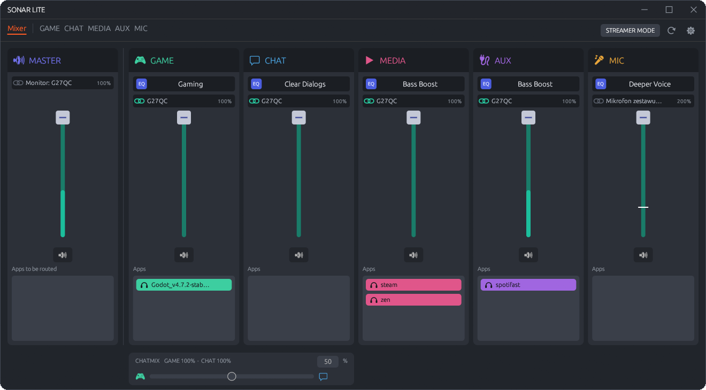
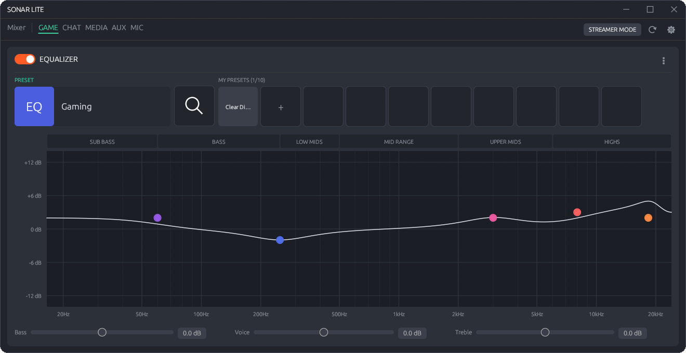
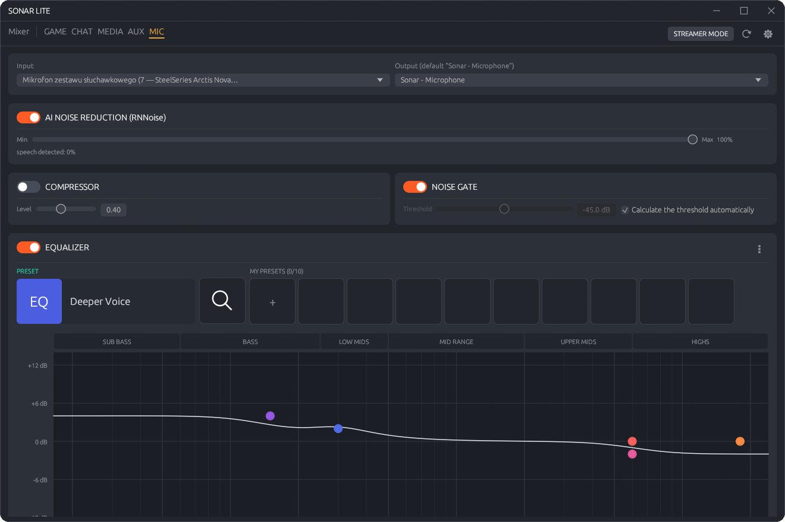

  

  
  
  

  Everything you use <b>SteelSeries Sonar</b> for, in one small window that lives in your tray.

  

## Why Sonar Lite

**Featherweight.** One portable exe in a zip of under 3 MB. No installer, no social media buttons, no account.

**Ready when you are.** Starts quickly, sits in the tray, and can start with Windows.

**Your devices, your order.** Give every channel a priority list of devices. Unplug your headset and the channel moves to the next
device by itself; plug it back and it returns.

**Drag, drop, done.** Send any app to any channel by dragging its chip onto it. No menus, no digging through Windows settings.

**Changes do not strand your music.** Change a device or an EQ while music is playing and Sonar Lite resumes whatever the change
paused.

**Built for streamers.** A separate stream mix with its own faders and EQ per source, sent to a virtual cable that OBS records.
What your viewers hear is independent of what you hear.

**Scriptable and open.** A command-line tool for your own automation, and the whole project is open source under the MIT license.

## Sound it your way

<table>
<tr>
<td width="50%" valign="top">

### Equalizer
Drag the markers on a Sonar-style graph or type exact gain, frequency and Q. Start from the built-in presets, add Bass / Voice /
Treble, and keep up to 10 presets of your own for every channel.

</td>
<td width="50%"></td>
</tr>
<tr>
<td width="50%"></td>
<td width="50%" valign="top">

### Microphone chain
Noise reduction, a noise gate that finds its own threshold, a compressor and an EQ, applied to your physical mic and delivered
as Sonar's virtual microphone to Discord, games and OBS.

</td>
</tr>
</table>

## Sonar Lite and GG

| | Sonar Lite | SteelSeries GG |
|---|---|---|
| Needs the full suite running | No | Yes, Sonar is part of it |
| Installation | None, unzip and run | Installer |
| Size | Under 3 MB | Full application suite |
| Source code | Open, MIT | Closed |
| Scope | Sonar mixer: channels, EQ, mic, stream mix | Everything GG does |

Sonar Lite is not a full replacement for GG. It uses the Sonar driver that GG installs, so you need GG installed
once. Spatial audio and global hotkeys are not implemented yet.

## Get started

1. Install **SteelSeries GG** (it contains Sonar), start it once and close it. GG should not run together with Sonar Lite.
2. Download the zip from [Releases](https://github.com/aerokero/sonar-lite/releases/latest), unzip it anywhere and run `SonarLite.exe`.

Requires Windows 11 and administrator rights, because the app writes the Sonar settings. Settings are kept in `%APPDATA%\SonarLite`.

## Legal

Not affiliated with SteelSeries. "SteelSeries", "GG" and "Sonar" are trademarks of their owners. Sonar Lite is released under the
[MIT License](LICENSE), contains no SteelSeries code and requires a separately installed GG/Sonar, which is subject to SteelSeries' own
license terms. Provided as is, without warranty; changing audio driver settings is at your own risk.
